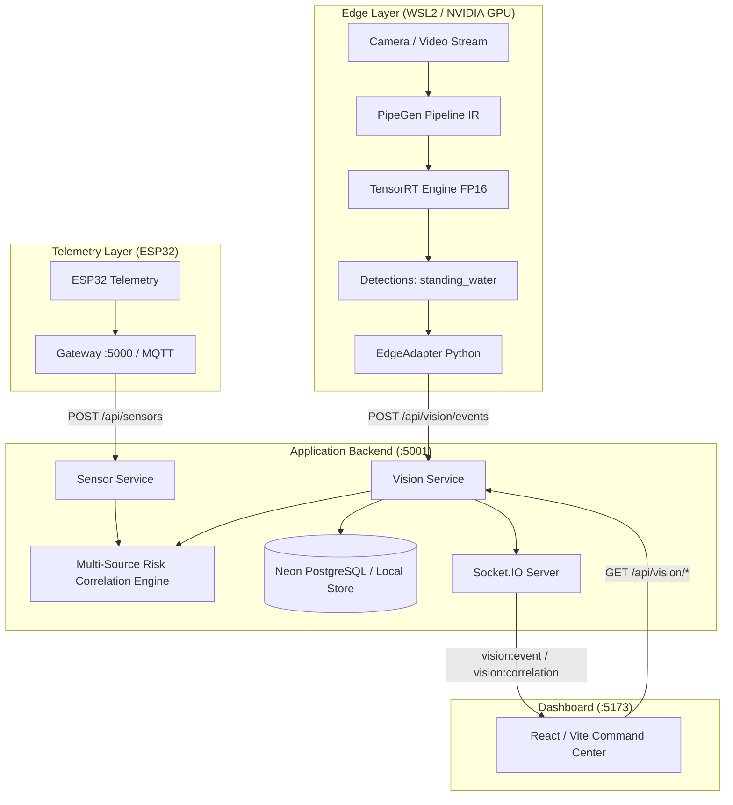

# JAL-RAKSHAK Edge — System Architecture

**Vision-Grounded Water-Hazard Detection and Risk-Intelligence Platform**

---

## 1. System Overview

**JAL-RAKSHAK Edge** combines two independent, complementary observation layers:
1. **Physical Sensor Ingestion & Telemetry:** ESP32 ultrasonic depth sensor, tipping-bucket rainfall, temperature, rate-of-rise calculation, and historical baseline anomaly detection.
2. **Edge Visual Observation Pipeline:** Video camera streams compiled via **PipeGen v0.5.1** into **TensorRT FP16 engines**, detecting standing road water and surface waterlogging directly on local edge hardware (NVIDIA GeForce RTX 4050 Laptop GPU).



---

## 2. Sensor-to-Backend Flow

1. **Edge Node Ingestion:** ESP32 measures ultrasonic distance to water surface ($d$) and rain pulse counters ($r$), calculating rate-of-rise ($\Delta d / \Delta t$) and acceleration ($\Delta^2 d / \Delta t^2$).
2. **Gateway:** Ingests readings over HTTP/MQTT at port `5000` (`jal-rakshak-backend`).
3. **Sensor Service:** Transmits telemetry to main backend port `5001` (`/api/sensors`).
4. **Behavior Engine:** Evaluates deviation from historical baselines (`calculateHistoricalBaseline`).
5. **Rule & ML Classification:** Classifies events (`FLOOD_ESCALATION`, `ABNORMAL_WATER_LOSS`, `SENSOR_ANOMALY`, `NORMAL`) and computes rule-based risk score ($0-100$).

---

## 3. Video-to-TensorRT-to-DeepStream Edge Pipeline

1. **Source Node:** Input camera stream (RTSP/V4L2) or recorded field clip (`samples/road_waterlogging_sample.mp4`).
2. **PipeGen Pipeline IR (`config/pipeline_ir.json`):** Defines pipeline stages:
   - `Preprocess`: 640x640 resize, RGB normalization ($1/255.0$).
   - `TensorRTInference`: Compiled engine `yolov8n_water_hazard_fp16.engine` targeting compute capability 8.9 (Ada Lovelace).
   - `NMSPostprocess`: Confidence threshold $0.50$, IoU $0.45$.
   - `EventSink`: Output to EdgeAdapter.
3. **Execution Path:** Compiled via PipeGen v0.5.1 compiler / `trtexec` inside WSL2 Ubuntu 24.04 with NVIDIA Container Toolkit.

---

## 4. Edge Adapter (`vision-edge/adapter/edge_adapter.py`)

- **Event Normalization:** Normalizes raw model bounding boxes and scores into canonical UTC ISO-8601 schema.
- **De-duplication & Cooldown:** Configurable cooldown window (default: $30\text{ s}$) per camera to prevent dashboard flooding from repeated frame detections.
- **Resilient Transport:** HTTP `POST` to `/api/vision/events` with retry and exponential backoff.
- **Pipeline Heartbeat:** Emits heartbeat every $10\text{ s}$ with live FPS, latency, and status to `/api/vision/heartbeat`.

---

## 5. Multi-Source Risk Correlation Logic (Step Seven)

The backend correlation engine (`backend/services/visionService.js`) unifies the two modalities without fabricating flood depth from visual images:

| Classification | Condition | Description & Attribution |
| :--- | :--- | :--- |
| `MULTI_SOURCE_RISK` | Sensor risk $\ge 50$ **AND** visual confidence $\ge 0.50$ at mapped location within correlation window ($300\text{ s}$) | High flood hazard confirmed across independent modalities: physical rise confirmed by visual road water. |
| `VISUAL_OBSERVATION_ONLY` | Visual hazard detected, but sensor risk is normal or device is unmapped | Standing road water detected visually. Underlying sensor station indicates safe or unlinked levels. |
| `SENSOR_PREDICTION_ONLY` | Sensor risk elevated, but no camera confirms visual standing water | Telemetry indicates elevated water behavior; camera field-of-view does not show standing water. |

**Preservation Principle:** Camera confidence is not converted into arbitrary flood depth or millimeter rise rate. Physical sensors measure water level, while edge vision provides ground truth observation of road inundation.

---

## 6. Neon PostgreSQL Database Schema

Stored in `vision_events` table:
```sql
CREATE TABLE IF NOT EXISTS vision_events (
    event_id BIGSERIAL PRIMARY KEY,
    source VARCHAR(50) DEFAULT 'vision',
    event_type VARCHAR(100) NOT NULL,
    class_name VARCHAR(100) NOT NULL,
    confidence DOUBLE PRECISION NOT NULL,
    camera_id VARCHAR(100) NOT NULL,
    location_id VARCHAR(100),
    timestamp TIMESTAMPTZ NOT NULL,
    bbox JSONB,
    evidence_url TEXT,
    track_id VARCHAR(100),
    model_id VARCHAR(100),
    payload JSONB,
    created_at TIMESTAMPTZ DEFAULT NOW()
);

CREATE INDEX idx_vision_events_timestamp ON vision_events(timestamp DESC);
CREATE INDEX idx_vision_events_camera ON vision_events(camera_id);
```
*(Gracefully falls back to local JSON collection store when `DATABASE_URL` is omitted in development).*

---

## 7. Real-Time Frontend Dashboard (`JAL-RAKSHAK-frontend`)

Connected via Socket.IO events on port `5001`:
- `vision:event`: Pushes new visual observations live without page reload.
- `vision:correlation`: Pushes updated multi-source correlation assessment.
- `vision:status`: Pushes live FPS, latency, and pipeline state.
- Integrated into both the main **Command Center (`/dashboard`)** and the dedicated **Vision Edge (`/vision-edge`)** page.
